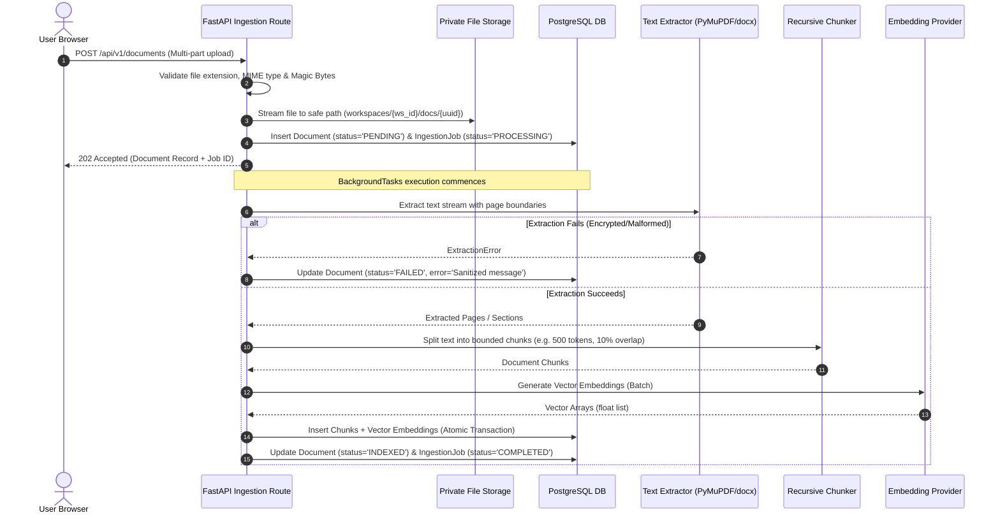
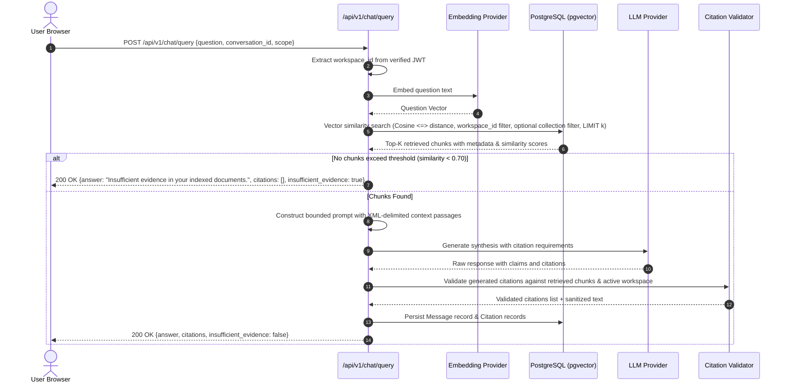

# System Architecture — Mnemos

**Document Reference:** ARCH-MNEMOS-1.0  
**Related Documents:** [DATABASE_DESIGN.md](file:///c:/Users/manoj/OneDrive/Desktop/Mnemos%20AI%20Knowledge%20Assitant/mnemos/docs/DATABASE_DESIGN.md), [API_SPECIFICATION.md](file:///c:/Users/manoj/OneDrive/Desktop/Mnemos%20AI%20Knowledge%20Assitant/mnemos/docs/API_SPECIFICATION.md), [SECURITY.md](file:///c:/Users/manoj/OneDrive/Desktop/Mnemos%20AI%20Knowledge%20Assitant/mnemos/docs/SECURITY.md)

---

## 1. High-Level System Architecture

Mnemos is organized as a high-cohesion, decoupled monorepo composed of a modern Next.js client, a high-performance Python FastAPI application server, PostgreSQL with the `pgvector` extension, and private file storage.

```mermaid
graph TB
    subgraph Client ["Client Layer (apps/web)"]
        Browser["Next.js / React (App Router)"]
        State["State Hooks & UI Components"]
        ApiClient["Type-safe Fetch Client"]
        Browser --> State --> ApiClient
    end

    subgraph ApiGateway ["Application API Layer (apps/api)"]
        FastAPI["FastAPI App (uvicorn)"]
        AuthMiddleware["JWT & Workspace Guard"]
        Router["Router /api/v1"]
        FastAPI --> AuthMiddleware --> Router
    end

    subgraph CoreServices ["Service Layer"]
        DocService["Document & Ingestion Service"]
        RagService["RAG & Citation Service"]
        EmbedService["Embedding Provider Interface"]
        LLMService["LLM Generation Interface"]
        Router --> DocService
        Router --> RagService
        RagService --> EmbedService
        RagService --> LLMService
        DocService --> EmbedService
    end

    subgraph DataStorage ["Storage & Persistence"]
        DB[(PostgreSQL + pgvector)]
        FileStore[("Private Storage (Local / S3)")]
        DocService --> FileStore
        DocService --> DB
        RagService --> DB
    end

    subgraph ExternalAI ["External AI Providers"]
        OpenAIAPI["OpenAI API / Gemini API / Local Mock"]
        EmbedService -.-> ExternalAI
        LLMService -.-> ExternalAI
    end
```

---

## 2. Ingestion Pipeline & Data Flow

The ingestion pipeline handles asynchronous document processing, extraction, normalization, chunking, and vector embedding.



---

## 3. RAG Query & Citation Verification Flow

The query flow enforces strict workspace authorization, retrieval bounding, prompt injection prevention, and server-side citation validation.



---

## 4. Monorepo Structure

```
mnemos/
├── apps/
│   ├── web/                     # Next.js 14+ App Router, Tailwind CSS, Lucide
│   │   ├── src/
│   │   │   ├── app/             # Layouts, (auth), (dashboard), (chat)
│   │   │   ├── components/      # Design system primitives, modals, tables
│   │   │   ├── features/        # Feature modules: chat, documents, collections
│   │   │   ├── hooks/           # Custom React hooks (useDocuments, useChat)
│   │   │   ├── lib/             # Utility functions, fetch client
│   │   │   └── types/           # TypeScript API interfaces & DTOs
│   │   ├── .env.example
│   │   └── package.json
│   │
│   └── api/                     # Python 3.11+, FastAPI, SQLAlchemy 2.x, Alembic
│       ├── app/
│       │   ├── api/routes/      # Endpoint routers (/health, /documents, /chat)
│       │   ├── core/            # Config, security, logging, exceptions
│       │   ├── db/              # Session, engine, base model
│       │   ├── models/          # SQLAlchemy ORM models
│       │   ├── schemas/         # Pydantic v2 validation schemas
│       │   ├── services/        # Business logic (Document, RAG, Ingestion)
│       │   ├── repositories/    # Database query abstractions
│       │   ├── ingestion/       # File parsers (PyMuPDF, docx, txt) & chunker
│       │   ├── embeddings/      # Provider abstractions (OpenAI, Gemini, Mock)
│       │   ├── retrieval/       # Vector similarity queries via pgvector
│       │   ├── rag/             # Prompt builders & citation validators
│       │   ├── security/        # JWT handling, password hashing, guards
│       │   ├── storage/         # Local private & S3 storage handlers
│       │   └── tests/           # Unit & integration test suites
│       ├── alembic/             # Database migration scripts
│       ├── pyproject.toml
│       └── .env.example
│
├── docs/                        # Architecture & specifications
├── scripts/                     # Seeders & development helpers
├── docker-compose.yml           # PostgreSQL + pgvector, API, Web
├── .gitignore
├── .editorconfig
└── README.md
```
