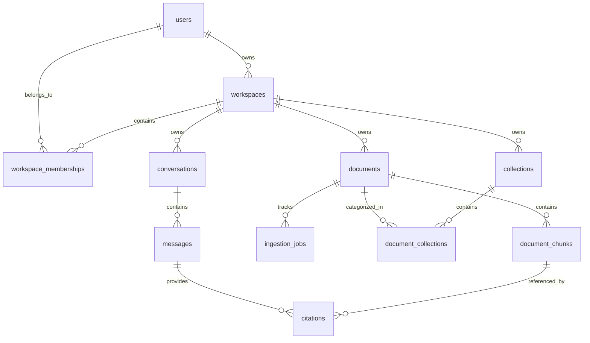

# Database Design Specification — Mnemos

**Document Reference:** DB-MNEMOS-1.0  
**Target Engine:** PostgreSQL 16+ with `pgvector` extension  
**Related Documents:** [ARCHITECTURE.md](file:///c:/Users/manoj/OneDrive/Desktop/Mnemos%20AI%20Knowledge%20Assitant/mnemos/docs/ARCHITECTURE.md), [SECURITY.md](file:///c:/Users/manoj/OneDrive/Desktop/Mnemos%20AI%20Knowledge%20Assitant/mnemos/docs/SECURITY.md)

---

## 1. Design Principles & Data Isolation

1. **UUID Primary Keys:** All entities utilize version 4 UUIDs (`uuid_generate_v4()`) to prevent enumeration attacks and simplify distributed identifiers.
2. **Strict Multi-Tenant Isolation:** Every document, document chunk, collection, conversation, and message carries a mandatory foreign key to `workspaces(id)`. Direct filtering by `workspace_id` is enforced on every query.
3. **Data Integrity via Foreign Keys & Cascades:** Deleting a document automatically cascades to delete all its associated chunks, citations, and collection assignments.
4. **Vector Column Consistency:** Vector embeddings are stored in a dedicated `pgvector` column `vector(1536)` (or configured dimension), indexed via HNSW with Cosine distance.
5. **Alembic Migrations:** All schema alterations are version-controlled through explicit Python migration files.

---

## 2. Entity Relationship Diagram (ERD)



---

## 3. Detailed Entity Schemas

### 3.1 `users`
Represents an authenticated user account.
```sql
CREATE TABLE users (
    id UUID PRIMARY KEY DEFAULT gen_random_uuid(),
    email VARCHAR(255) NOT NULL UNIQUE,
    password_hash VARCHAR(255) NOT NULL,
    full_name VARCHAR(150),
    status VARCHAR(50) NOT NULL DEFAULT 'ACTIVE', -- ACTIVE, SUSPENDED
    created_at TIMESTAMPTZ NOT NULL DEFAULT NOW(),
    updated_at TIMESTAMPTZ NOT NULL DEFAULT NOW()
);
CREATE INDEX idx_users_email ON users(email);
```

### 3.2 `workspaces` & `workspace_memberships`
Defines data boundaries. MVP enforces single owner per workspace; schema supports multi-member expansion.
```sql
CREATE TABLE workspaces (
    id UUID PRIMARY KEY DEFAULT gen_random_uuid(),
    name VARCHAR(100) NOT NULL,
    owner_id UUID NOT NULL REFERENCES users(id) ON DELETE RESTRICT,
    created_at TIMESTAMPTZ NOT NULL DEFAULT NOW(),
    updated_at TIMESTAMPTZ NOT NULL DEFAULT NOW()
);
CREATE INDEX idx_workspaces_owner ON workspaces(owner_id);

CREATE TABLE workspace_memberships (
    id UUID PRIMARY KEY DEFAULT gen_random_uuid(),
    workspace_id UUID NOT NULL REFERENCES workspaces(id) ON DELETE CASCADE,
    user_id UUID NOT NULL REFERENCES users(id) ON DELETE CASCADE,
    role VARCHAR(50) NOT NULL DEFAULT 'OWNER', -- OWNER, MEMBER, VIEWER
    status VARCHAR(50) NOT NULL DEFAULT 'ACTIVE',
    created_at TIMESTAMPTZ NOT NULL DEFAULT NOW(),
    UNIQUE(workspace_id, user_id)
);
```

### 3.3 `documents`
Stores metadata and status for uploaded files.
```sql
CREATE TABLE documents (
    id UUID PRIMARY KEY DEFAULT gen_random_uuid(),
    workspace_id UUID NOT NULL REFERENCES workspaces(id) ON DELETE CASCADE,
    uploader_id UUID NOT NULL REFERENCES users(id) ON DELETE RESTRICT,
    original_filename VARCHAR(255) NOT NULL,
    storage_key VARCHAR(500) NOT NULL UNIQUE,
    mime_type VARCHAR(100) NOT NULL,
    file_size_bytes BIGINT NOT NULL,
    content_hash VARCHAR(64) NOT NULL, -- SHA-256
    status VARCHAR(50) NOT NULL DEFAULT 'PENDING', -- PENDING, PROCESSING, INDEXED, FAILED
    error_message TEXT, -- Sanitized user-facing error
    page_count INTEGER,
    created_at TIMESTAMPTZ NOT NULL DEFAULT NOW(),
    updated_at TIMESTAMPTZ NOT NULL DEFAULT NOW()
);
CREATE INDEX idx_documents_workspace_status ON documents(workspace_id, status);
CREATE INDEX idx_documents_content_hash ON documents(workspace_id, content_hash);
```

### 3.4 `document_chunks`
Stores segmented passages, metadata, and pgvector embeddings.
```sql
CREATE TABLE document_chunks (
    id UUID PRIMARY KEY DEFAULT gen_random_uuid(),
    document_id UUID NOT NULL REFERENCES documents(id) ON DELETE CASCADE,
    workspace_id UUID NOT NULL REFERENCES workspaces(id) ON DELETE CASCADE,
    chunk_index INTEGER NOT NULL,
    content TEXT NOT NULL,
    page_number INTEGER, -- 1-indexed for PDFs; NULL for unpaginated DOCX/TXT
    start_char_offset INTEGER,
    end_char_offset INTEGER,
    token_count INTEGER NOT NULL,
    embedding vector(768), -- Optimized for Google Gemini (text-embedding-004 / 768-dim Matryoshka)
    embedding_model VARCHAR(100) NOT NULL,
    embedding_version VARCHAR(50) NOT NULL,
    created_at TIMESTAMPTZ NOT NULL DEFAULT NOW()
);
CREATE INDEX idx_chunks_workspace ON document_chunks(workspace_id);
CREATE INDEX idx_chunks_document ON document_chunks(document_id);
-- HNSW index for high-speed cosine similarity search
CREATE INDEX idx_chunks_embedding_hnsw ON document_chunks 
USING hnsw (embedding vector_cosine_ops) 
WITH (m = 16, ef_construction = 64);
```

### 3.5 `collections` & `document_collections`
Allows logical grouping of documents within a workspace.
```sql
CREATE TABLE collections (
    id UUID PRIMARY KEY DEFAULT gen_random_uuid(),
    workspace_id UUID NOT NULL REFERENCES workspaces(id) ON DELETE CASCADE,
    name VARCHAR(100) NOT NULL,
    description TEXT,
    created_at TIMESTAMPTZ NOT NULL DEFAULT NOW(),
    UNIQUE(workspace_id, name)
);

CREATE TABLE document_collections (
    collection_id UUID NOT NULL REFERENCES collections(id) ON DELETE CASCADE,
    document_id UUID NOT NULL REFERENCES documents(id) ON DELETE CASCADE,
    created_at TIMESTAMPTZ NOT NULL DEFAULT NOW(),
    PRIMARY KEY (collection_id, document_id)
);
```

### 3.6 `conversations`, `messages`, and `citations`
Maintains conversational history, token usage, and verifiable citations.
```sql
CREATE TABLE conversations (
    id UUID PRIMARY KEY DEFAULT gen_random_uuid(),
    workspace_id UUID NOT NULL REFERENCES workspaces(id) ON DELETE CASCADE,
    user_id UUID NOT NULL REFERENCES users(id) ON DELETE RESTRICT,
    title VARCHAR(255) NOT NULL,
    scope VARCHAR(50) NOT NULL DEFAULT 'WORKSPACE', -- WORKSPACE, COLLECTION
    scope_id UUID, -- Reference to collection if scoped
    created_at TIMESTAMPTZ NOT NULL DEFAULT NOW(),
    updated_at TIMESTAMPTZ NOT NULL DEFAULT NOW()
);

CREATE TABLE messages (
    id UUID PRIMARY KEY DEFAULT gen_random_uuid(),
    conversation_id UUID NOT NULL REFERENCES conversations(id) ON DELETE CASCADE,
    role VARCHAR(20) NOT NULL, -- user, assistant, system
    content TEXT NOT NULL,
    model_name VARCHAR(100),
    prompt_tokens INTEGER DEFAULT 0,
    completion_tokens INTEGER DEFAULT 0,
    insufficient_evidence BOOLEAN DEFAULT FALSE,
    created_at TIMESTAMPTZ NOT NULL DEFAULT NOW()
);

CREATE TABLE citations (
    id UUID PRIMARY KEY DEFAULT gen_random_uuid(),
    message_id UUID NOT NULL REFERENCES messages(id) ON DELETE CASCADE,
    chunk_id UUID REFERENCES document_chunks(id) ON DELETE SET NULL,
    document_id UUID NOT NULL REFERENCES documents(id) ON DELETE CASCADE,
    document_title VARCHAR(255) NOT NULL,
    page_number INTEGER,
    excerpt TEXT NOT NULL,
    similarity_score FLOAT,
    created_at TIMESTAMPTZ NOT NULL DEFAULT NOW()
);
CREATE INDEX idx_citations_message ON citations(message_id);
```

### 3.7 `ingestion_jobs`
Audit trail and retry management for background ingestion tasks.
```sql
CREATE TABLE ingestion_jobs (
    id UUID PRIMARY KEY DEFAULT gen_random_uuid(),
    document_id UUID NOT NULL REFERENCES documents(id) ON DELETE CASCADE,
    status VARCHAR(50) NOT NULL DEFAULT 'PENDING', -- PENDING, PARSING, EMBEDDING, COMPLETED, FAILED
    stage VARCHAR(50) NOT NULL DEFAULT 'QUEUED',
    retry_count INTEGER NOT NULL DEFAULT 0,
    safe_error TEXT,
    created_at TIMESTAMPTZ NOT NULL DEFAULT NOW(),
    updated_at TIMESTAMPTZ NOT NULL DEFAULT NOW()
);
```
