# Implementation Plan & Execution Roadmap — Mnemos

**Document Reference:** PLAN-MNEMOS-1.0  
**Related Documents:** [ARCHITECTURE.md](file:///c:/Users/manoj/OneDrive/Desktop/Mnemos%20AI%20Knowledge%20Assitant/mnemos/docs/ARCHITECTURE.md), [PRD.md](file:///c:/Users/manoj/OneDrive/Desktop/Mnemos%20AI%20Knowledge%20Assitant/mnemos/docs/PRD.md), [TEST_PLAN.md](file:///c:/Users/manoj/OneDrive/Desktop/Mnemos%20AI%20Knowledge%20Assitant/mnemos/docs/TEST_PLAN.md)

---

## 1. Roadmap & Milestone Phasing

The implementation follows a reviewable, milestone-gated engineering methodology. Each milestone delivers concrete, verified functionality with zero mocked claims.

```mermaid
gantt
    title Mnemos Implementation Roadmap
    dateFormat  X
    axisFormat  Day %d

    section Foundations
    Milestone A (Design & Stitch)       :done, a1, 0, 1
    Milestone B (Requirements & Arch)   :active, a2, 1, 2
    Milestone C (Repo Foundation)       :a3, 2, 3
    Milestone D (DB & Auth)             :a4, 3, 4

    section Core Pipeline
    Milestone E (Ingestion Pipeline)    :a5, 4, 5
    Milestone F (Embeddings & Retrieval):a6, 5, 6
    Milestone G (RAG & Groundedness)    :a7, 6, 7

    section Experience & Polish
    Milestone H (Frontend Components)   :a8, 7, 8
    Milestone I (Integration & E2E)     :a9, 8, 9
    Milestone J (Quality & Security QA) :a10, 9, 10
    Milestone K (Deployment Prep)       :a11, 10, 11
    Milestone L (Portfolio & Docs)      :a12, 11, 12
```

---

## 2. Milestone Detailed Breakdown

### Milestone C: Repository Foundation
- **Goal:** Initialize monorepo directory layout, virtual environments, base configuration files, and verified health endpoints.
- **Deliverables:**
  - `docker-compose.yml`, `.gitignore`, `.editorconfig`, root `README.md`.
  - `apps/api/`: `pyproject.toml`, FastAPI app factory, config loader via `pydantic-settings`, CORS middleware, `/health` and `/ready` endpoints, pytest baseline.
  - `apps/web/`: Next.js initialized with TypeScript, Tailwind CSS, Lucide icons, `.env.example`.
- **Verification:** Start API and Web servers locally; confirm `GET /health` returns 200 OK.

### Milestone D: Database & Authentication
- **Goal:** Set up PostgreSQL with pgvector, Alembic migrations, SQLAlchemy 2.x async models, and secure auth.
- **Deliverables:**
  - Alembic migration scripts initializing all tables: `users`, `workspaces`, `workspace_memberships`, `documents`, `document_chunks`, `collections`, `conversations`, `messages`, `citations`, `ingestion_jobs`.
  - Argon2/bcrypt password hashing service + JWT cookie session authentication.
  - `/api/v1/auth/register`, `/api/v1/auth/login`, `/api/v1/auth/me`.
- **Verification:** Automated tests verifying registration, login, JWT validation, and cross-workspace access rejection.

### Milestone E: Document Ingestion Pipeline
- **Goal:** Build robust file upload, validation, safe storage, and text extraction with pagination preservation.
- **Deliverables:**
  - Secure storage adapter (local private filesystem + S3 interface).
  - File validators (MIME type + magic bytes + 50MB size limit).
  - Text extractors: PyMuPDF for PDF (retaining page numbers), python-docx for DOCX, plain text for TXT.
  - Recursive text chunker (500 tokens, 10% overlap).
  - Background ingestion worker with live status updates (`PENDING` -> `PARSING` -> `INDEXED`).
- **Verification:** Test suite verifying valid uploads, corrupted file rejections, empty file alerts, and chunk pagination accuracy.

### Milestone F: Embeddings & Vector Retrieval
- **Goal:** Implement provider-agnostic vector generation and permission-aware similarity search using pgvector.
- **Deliverables:**
  - `EmbeddingProvider` abstract base class with OpenAI, Gemini, and Mock implementations.
  - Chunk embedding generator with batch processing.
  - Repository vector queries using pgvector Cosine distance (`<=>`) with mandatory `workspace_id` filtering and collection scoping.
- **Verification:** Unit tests with mock vectors; integration tests verifying vector ranking and cross-workspace isolation.

### Milestone G: Grounded RAG & Citation Validation
- **Goal:** Complete the evidence-grounded Q&A engine with deterministic citation validation and insufficient evidence states.
- **Deliverables:**
  - Prompt construction pipeline with XML-delimited untrusted context.
  - `LLMProvider` interface (OpenAI, Gemini, Mock).
  - `CitationValidator` verifying cited chunk IDs against retrieved passages and workspace ownership.
  - Chat query endpoint: `POST /api/v1/chat/query`.
- **Verification:** RAG evaluation dataset benchmark (grounded answers, insufficient evidence fallbacks, and prompt injection defense).

### Milestone H: Frontend UI Components
- **Goal:** Build pixel-perfect Next.js components translating approved Milestone A designs into accessible code.
- **Deliverables:**
  - Knowledge Dashboard: Sidebar, Dropzone upload, statistics overview cards, recent documents table with live status badges.
  - AI Chat Workspace: Thread list, message stream, grounded response cards with citation pills, scope selector dropdown, suggested prompt pills, and Source Inspection Drawer with text highlight.
- **Verification:** React component rendering tests, responsive viewport checks, and accessibility audits.

### Milestone I: Full Integration & End-to-End Verification
- **Goal:** Wire frontend and backend into a seamless, interactive workflow.
- **Deliverables:**
  - Typed API client with cookie handling and optimistic updates.
  - Real-time polling/SSE for document processing progress.
  - End-to-end verified user journey: Register -> Upload PDF -> Ingest -> Ask question -> Verify citation -> Inspect source passage.
- **Verification:** Automated Playwright/Cypress or integration test script asserting full end-to-end flow.

### Milestone J: Quality & Security QA
- **Goal:** Deep security audits, rate limiting, and defect remediation.
- **Deliverables:** Rate limiting middleware, sanitized error handlers, performance benchmarks (<150ms retrieval).
- **Verification:** Full test suite execution across unit, integration, and security checks.

### Milestone K: Deployment Preparation
- **Goal:** Production containerization, environment audits, and cost/hosting analysis.
- **Deliverables:** Production Dockerfiles, reverse proxy configs, hosting runbook (Supabase/Neon/Render).
- **Verification:** Dry-run production container builds. *Stop for user approval before any live deployment.*

### Milestone L: Portfolio Assets & Final Review
- **Goal:** Create portfolio-grade documentation and artifacts showcasing architectural mastery.
- **Deliverables:**
  - Comprehensive, beautifully structured `README.md` with system overview, architecture diagrams, RAG verification methodology, screenshots, and setup guide.
  - Senior engineer interview talking points detailing trade-offs, security model, and pgvector performance.
