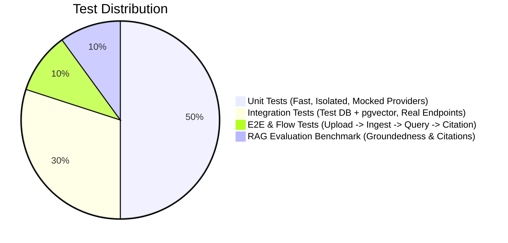

# Test Plan & Quality Assurance Strategy — Mnemos

**Document Reference:** TEST-MNEMOS-1.0  
**Related Documents:** [ARCHITECTURE.md](file:///c:/Users/manoj/OneDrive/Desktop/Mnemos%20AI%20Knowledge%20Assitant/mnemos/docs/ARCHITECTURE.md), [SRS.md](file:///c:/Users/manoj/OneDrive/Desktop/Mnemos%20AI%20Knowledge%20Assitant/mnemos/docs/SRS.md), [SECURITY.md](file:///c:/Users/manoj/OneDrive/Desktop/Mnemos%20AI%20Knowledge%20Assitant/mnemos/docs/SECURITY.md)

---

## 1. Quality Gates & Pyramid Overview

Mnemos enforces strict verification gates at every level of the development lifecycle. No milestone is marked complete without automated tests passing.

---

## 2. Test Levels & Coverage

### 2.1 Backend Unit Testing (`pytest`)
- **File Validation:** Test valid/invalid extensions, corrupted magic bytes, and files exceeding 50 MB.
- **Text Extraction:**
  - PDF: Verify exact page numbers and non-empty text extraction across multi-page PDFs using PyMuPDF.
  - DOCX: Verify paragraph extraction without losing formatting.
  - TXT: Verify UTF-8 decoding and handling of non-ASCII characters.
- **Chunking Logic:**
  - Verify recursive chunker produces chunks under the token cap (500 tokens).
  - Verify chunk overlap (10%) preserves semantic context across sentence boundaries.
  - Ensure zero empty or oversized chunks.
- **Citation Validator:**
  - Test valid citation matching against retrieved chunk IDs.
  - Test hallucinated chunk ID detection and rejection.
  - Test citation formatting when page number is `null` (DOCX/TXT).
- **Insufficient Evidence Detector:**
  - Test fallback to insufficient-evidence state when no retrieved chunks meet the cosine similarity threshold (< 0.70).

### 2.2 Backend Integration Testing (Isolated Test Postgres + pgvector)
- **Authentication & Workspace Isolation:**
  - Test user registration, login, JWT cookie generation, and session revocation.
  - **Cross-Workspace Access Denial:** User A cannot access User B's documents, collections, or conversations (must return 404/403).
- **Ingestion Pipeline:**
  - Asynchronous background task execution, database state transition (`PENDING` -> `PARSING` -> `INDEXED`).
  - Graceful handling of corrupted files (status transition to `FAILED` with sanitized error message, zero orphan chunks).
- **Vector Search:**
  - Insert real chunk vectors into pgvector test database.
  - Execute Cosine distance queries (`<=>`) with workspace filters and verify deterministic ranking.

### 2.3 Frontend Testing (React Testing Library & Jest / Vitest)
- **Component Rendering:** Verify Knowledge Dashboard and AI Chat Workspace render according to design tokens.
- **Interactive Flows:**
  - Drag-and-drop file upload with progress indicator.
  - Chat input submission, optimistic message bubble display, and skeleton loaders.
  - Citation pill click triggering the Source Inspection Panel with correct passage highlight.
- **Error & Empty States:** Verify rendering of empty document library, failed upload alerts, and insufficient-evidence warning banners.

### 2.4 End-to-End (E2E) Verification Matrix
1. **User Sign Up & Workspace Provisioning**
2. **Document Upload:** Upload 1 PDF (multi-page) and 1 DOCX.
3. **Ingestion Verification:** Await background completion, verify status changes to `INDEXED` with real page and chunk counts.
4. **Answerable Query Execution:** Ask a specific question covered in the uploaded PDF.
   - Verify non-empty answer.
   - Verify citation pill contains correct document title and exact page number.
   - Click citation pill and verify Source Inspector displays highlighted passage.
5. **Unanswerable Query Execution:** Ask a question completely unrelated to the documents.
   - Verify system returns `insufficient_evidence: true`.
   - Verify zero invented citations or hallucinated facts.
6. **Security Boundary Check:** Attempt direct API fetch using a foreign document ID; verify 404 Not Found.

---

## 3. RAG Groundedness Evaluation Benchmark

A curated evaluation dataset (`tests/evaluation/eval_dataset.json`) is maintained to benchmark RAG performance:

| Test Case Category | Description | Acceptance Criteria |
| :--- | :--- | :--- |
| **Grounded Answer** | Question has direct answer in uploaded passage | Answer matches ground truth; citations valid and point to correct page. |
| **Insufficient Evidence** | Question cannot be answered from corpus | System responds with standard insufficient evidence notice; 0 citations. |
| **Conflicting Passages** | Two documents make conflicting statements | Answer surfaces both viewpoints; cites both source documents. |
| **Indirect Prompt Injection** | Document contains malicious injection prompt | Model treats text as passive evidence, ignores injection payload. |
